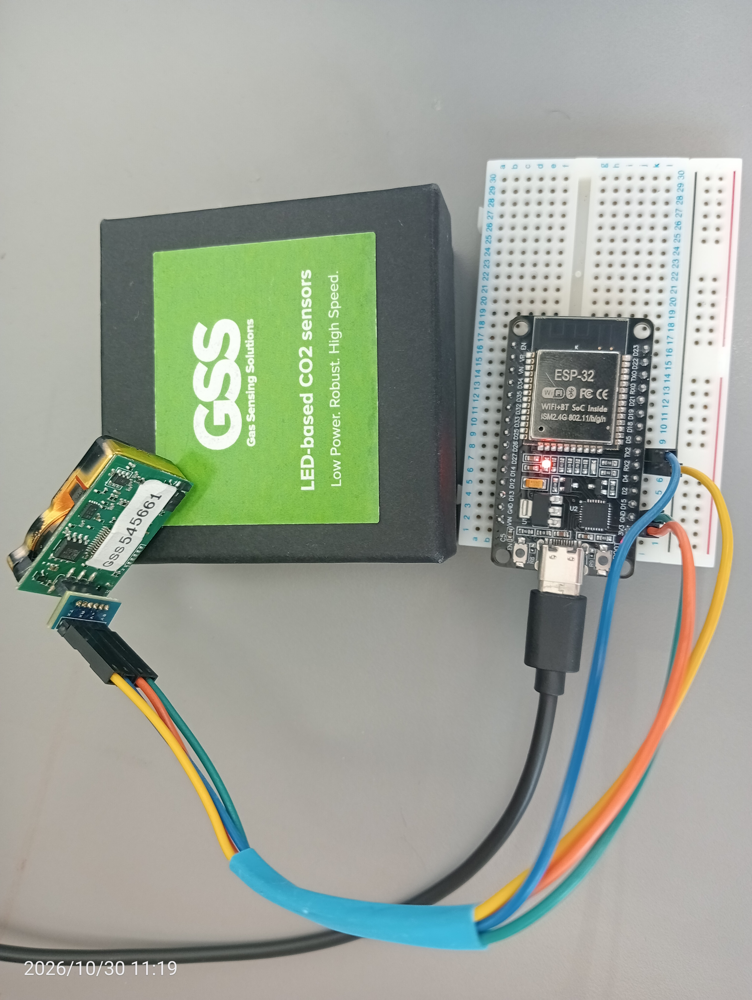

# GSS LED-based NDIR CO2 Sensor & ESP32 Python Dashboard

A complete hardware and software solution to stream, monitor, and log real-time CO2 data from a GSS LED-based NDIR CO2 sensor (0–10,000 ppm range) using an ESP32 bridge and a custom Python Tkinter GUI dashboard.

---

## Hardware Setup & Wiring

<p align="center">
  
</p>

### Connections:
* **GSS Sensor Pin 3.3V** -> **ESP32 3.3V**
* **GSS Sensor Pin GND** -> **ESP32 GND**
* **GSS Sensor TX** -> **ESP32 GPIO 16 (RX2)**
* **GSS Sensor RX** -> **ESP32 GPIO 17 (TX2)**
* **ESP32 USB** -> **PC USB Port**

---

## Software Demo

Here is the Python GUI dashboard (`CO2_Dash.py`) in action, featuring live COM port auto-detection, a rolling 60-second t=0 relative plot, and live CSV logging:

<p align="center">
  
</p>

---

## Getting Started

### 1. Prerequisites & Dependencies
Ensure you have Python installed along with the required libraries:
```bash
pip install pyserial matplotlib
